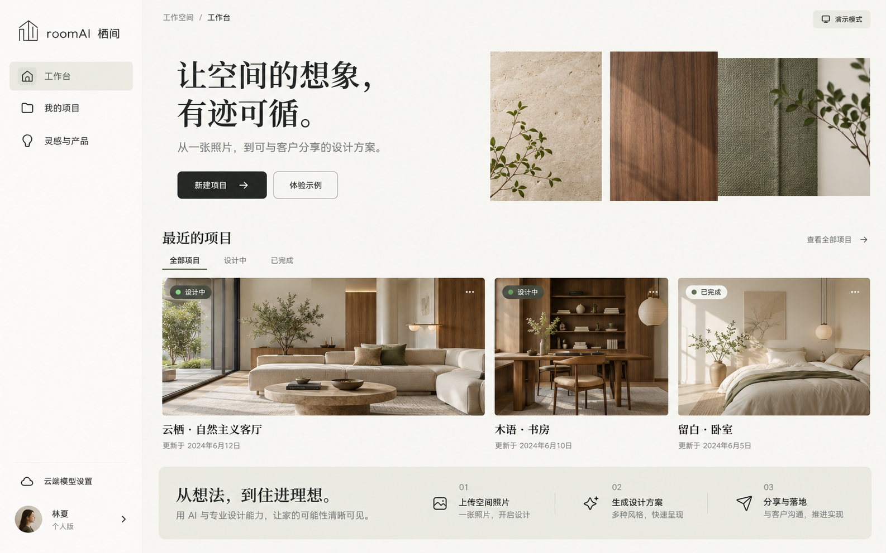
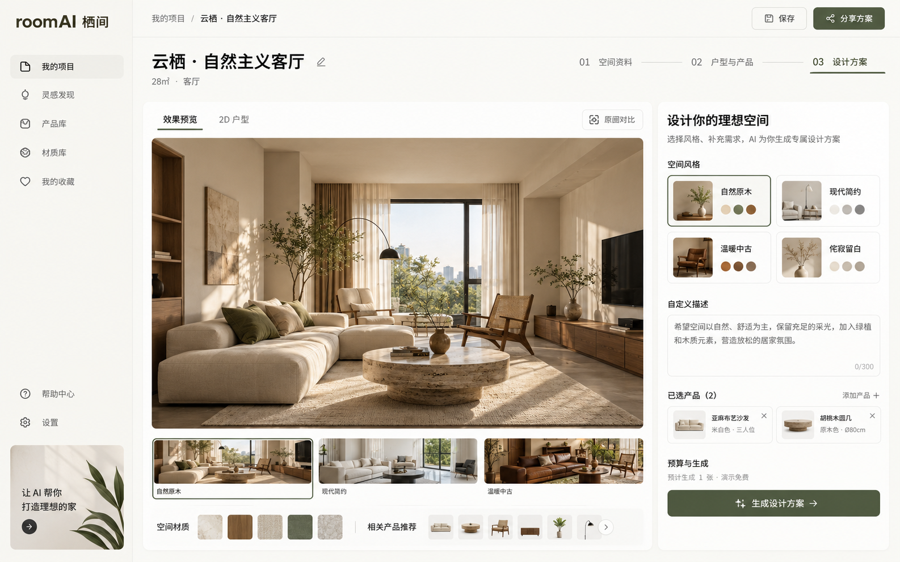
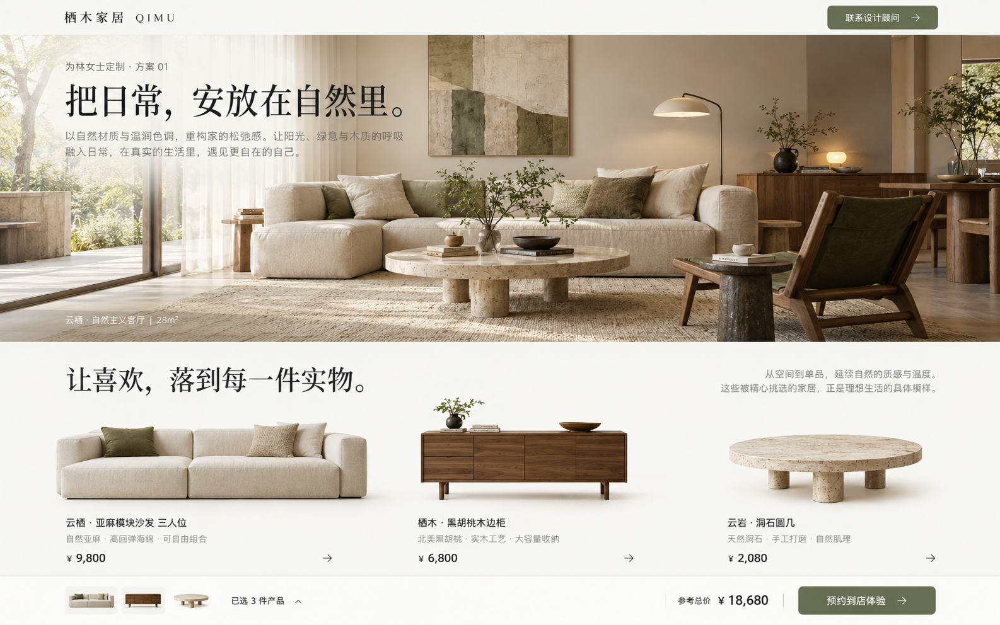

# roomAI · 栖间

**让空间的想象，有迹可循。**

从一张房间照片，到可与客户分享的家装设计方案。

[快速启动](#快速启动) · [界面预览](#界面预览) · [云端模型配置](#云端模型配置) · [开发与验证](#开发与验证) · [常见问题](#常见问题)

## 项目介绍

roomAI · 栖间是一款面向**家具建材品牌、门店、装修公司及室内设计工作室**的可视化空间设计 Demo。

上传房间照片、编辑户型尺寸、选择家具与材料，探索设计风格，再把效果图、产品清单和参考预算整理成客户专属展示页。客户无需注册即可查看分享方案、了解产品并提交咨询，帮助企业完成从空间构想到产品介绍的沟通流程。

项目参考 [Roomsmith](https://github.com/Rumeasiyan/roomsmith) 的结构化房间模型、程序绘图、尺寸确认和生成预算控制思路，复用了房间几何与绘图模块，并增加中文网页界面、后端服务和 Docker 部署。运行流程不依赖 Claude Code。

> **当前阶段：可运行 Demo。** 默认使用免费预置演示图片；云端图像生成适配层已实现，需自行配置模型服务后启用。当前未包含完整企业账号和商业化运营功能。

## 界面预览

以下是开发前生成的 **UI 设计原型**，用于确定布局、色彩和交互方向；部分细节与当前实现存在差异。

### 项目工作台

暖白背景、自然材质与项目图片，让设计工作从清晰的项目入口开始。

### 房间编辑与方案生成

在空间预览、2D 户型、产品搭配和风格设置之间切换，逐步完善方案。

### 客户方案展示

通过品牌化展示页呈现空间效果、产品信息和咨询入口。

## 功能与适用场景

| 功能 | 当前实现 |
|---|---|
| 项目管理 | 新建、搜索、状态筛选、自动保存和删除；每个新会话带三个示例项目 |
| 空间资料 | 上传 JPG、PNG、WebP 照片，填写客户称呼、空间用途、预算和需求 |
| 2D 户型 | 矩形和固定比例 L 形；尺寸修改、门窗添加、墙段与位置设置 |
| 家具布局 | 拖拽、方向键移动、90° 旋转、移除占位、撤销/重做；服务端边界和碰撞校验 |
| 产品搭配 | 预置家具/建材目录、产品详情、方案选择和参考总价 |
| 方案版本 | 自然原木、现代简约、温暖中古三个预置方向；保存并切换生成版本 |
| 原图对比 | 上传照片后，用滑块对比原始空间与方案图片 |
| 演示生成 | 异步创建方案记录，使用固定示例图，不收取模型费用 |
| 云端生成 | 对接图像 API，发送房间照片、几何参考图和所选产品照片 |
| 客户分享 | 默认七天有效的只读链接，可撤销；API 支持 1—30 天有效期 |
| 客户咨询 | 客户在分享页提交咨询，项目所有者可在编辑页查看 |
| 报告导出 | 中文 PDF 方案报告、Roomsmith SVG 尺寸平面图 |

家具/建材商家可用它展示产品组合及空间应用效果；装修公司/设计团队可用它演示客户需求整理、方案比较和设计沟通。

## 快速启动

### 环境要求

- Git。
- Docker Engine 或 Docker Desktop，以及 Docker Compose V2。
- 首次构建需联网下载基础镜像和项目依赖。
- 默认演示模式无需模型密钥和 GPU。

### 1. 获取项目

首次下载：

~~~bash
git clone https://github.com/keanuCN/roomAI-.git roomAI
cd roomAI
~~~

已有项目时，直接在项目根目录操作。

### 2. 创建本地配置

PowerShell：

~~~powershell
if (-not (Test-Path .env)) { Copy-Item .env.example .env }
~~~

Bash：

~~~bash
test -f .env || cp .env.example .env
~~~

默认配置为预置演示模式。已有配置时请保留自己的密钥和端口设置。

### 3. 构建并启动

在项目根目录执行：

~~~bash
docker compose up -d --build
~~~

| 入口 | 默认地址 | 用途 |
|---|---|---|
| 网页应用 | [http://localhost:3100](http://localhost:3100) | 工作台、编辑、产品与分享页面 |
| API 文档 | [http://localhost:8010/docs](http://localhost:8010/docs) | FastAPI 交互文档 |
| API 健康检查 | [http://localhost:8010/api/health](http://localhost:8010/api/health) | 确认后端状态 |
| MinIO 控制台 | [http://localhost:9011](http://localhost:9011) | 查看 Demo 对象存储；凭据来自本机 .env |

API 与 MinIO 控制台默认仅映射到本机地址；数据库与 Redis 不映射主机端口。网页应用使用主机的 3100 端口，从其他设备访问还取决于网络和防火墙设置。

### 常用运维命令

查看服务状态：

~~~bash
docker compose ps
~~~

查看 API 与 Worker 最近日志：

~~~bash
docker compose logs --tail 100 api worker
~~~

停止服务，保留数据库、队列和图片数据卷：

~~~bash
docker compose down
~~~

恢复已构建的服务：

~~~bash
docker compose up -d
~~~

## 使用流程

1. **进入工作台**：选择客厅、书房、卧室示例，或新建项目。
2. **填写资料**：上传房间照片，填写称呼、预算与设计需求。
3. **确认户型**：输入现场尺寸、调整门窗和家具，勾选尺寸确认。几何不合理时服务端会拒绝保存或生成。
4. **搭配产品**：挑选家具或材料；需要显示家具占位时，将其加入 2D 户型。
5. **生成方案**：选择风格，确认使用预置演示或云端生成，等待后台任务完成。
6. **比较与导出**：切换版本、与原图比较，导出 PDF 或 SVG 平面图。
7. **分享给客户**：创建只读链接，客户查看产品并提交咨询，所有者查看咨询或撤销链接。

内容变更后通常会在约 1.5 秒后自动保存；无效尺寸、家具碰撞等问题需要先修正。导出或离开前请检查保存状态。

### 演示与真实生成

- **预置演示**：使用项目内固定风格图，体验完整流程；不会根据当前尺寸、照片或所选产品重新生成。
- **云端生成**：把参考图片和提示词发送给模型，可能产生费用；仍需人工核对门窗、家具外观与尺度。
- 当前风格说明为预置文案，需求描述可编辑。TEXT_MODEL 尚未接入独立的文本/视觉分析流程。

## 系统架构

~~~mermaid
flowchart LR
    User["设计人员 / 客户"] --> Web["Next.js 网页"]
    Web --> API["FastAPI"]
    API --> DB[("PostgreSQL")]
    API --> Queue["Redis / RQ"]
    API --> Storage[("MinIO / S3")]
    Queue --> Worker["生成 Worker"]
    Worker --> Model["云端图像 API"]
    Worker --> DB
    Worker --> Storage
    API --> Geometry["Roomsmith 几何与 SVG 绘图"]
~~~

| 层 | 技术与职责 |
|---|---|
| 界面 | Next.js 16、React 19、TypeScript、Lucide 图标、响应式 CSS |
| 户型编辑 | SVG 坐标，拖拽与旋转；几何统一以米保存 |
| 服务端 | FastAPI、Pydantic、SQLAlchemy |
| 持久化 | Docker 使用 PostgreSQL；本地开发可回退到 SQLite |
| 任务 | Docker 使用 Redis + RQ；无 Redis 时使用 FastAPI 后台任务 |
| 图片存储 | MinIO、S3 兼容存储或本地文件 |
| 报告 | ReportLab 中文 PDF、Roomsmith SVG |
| 部署 | Docker Compose；前端独立镜像，API 与 Worker 使用相同后端构建方式 |

Compose 启动 web、api、worker、postgres、redis、minio 六个服务，并使用命名卷保存数据。

面积、墙段和开口由程序计算，几何参考图会作为模型输入之一。这不能保证生成图严格复现尺寸；需精确表达的位置应以结构化户型和尺寸图为准。

## 云端模型配置

在**服务器端**编辑项目根目录 .env。密钥不下发给浏览器，设置窗口仅展示配置状态。

### OpenAI 兼容图像编辑协议

服务需兼容 multipart POST /images/edits，并支持多张参考图输入：

~~~dotenv
ENABLE_LIVE_GENERATION=true
MODEL_PROVIDER=openai
MODEL_BASE_URL=https://api.openai.com/v1
MODEL_API_KEY=your-server-side-api-key
IMAGE_MODEL=your-image-model-id
~~~

### OpenRouter 图像输出协议

服务需支持 POST /chat/completions 的图像输入/输出，并在 message.images 中返回图片：

~~~dotenv
ENABLE_LIVE_GENERATION=true
MODEL_PROVIDER=openrouter
MODEL_BASE_URL=https://openrouter.ai/api/v1
MODEL_API_KEY=your-server-side-api-key
IMAGE_MODEL=your-supported-image-model-id
~~~

模型 ID 按服务商当前可用型号填写；普通文本聊天模型不能替代图像编辑模型。实现见 [providers.py](backend/app/providers.py)，图像编辑协议参考 [OpenAI Docs](https://developers.openai.com/api/reference/resources/images/methods/edit)。

修改配置后，重建并更新 API 与 Worker：

~~~bash
docker compose up -d --build api worker
~~~

### 环境变量

| 变量 | 默认值 | 说明 |
|---|---|---|
| WEB_PORT | 3100 | Docker 网页主机端口 |
| API_PORT | 8010 | Docker API 本机端口 |
| POSTGRES_PASSWORD | 示例配置中的开发密码 | 本地 Demo 数据库密码 |
| MINIO_ROOT_USER | roomai | 本地 MinIO 用户 |
| MINIO_ROOT_PASSWORD | 示例配置中的开发密码 | 本地 MinIO 密码 |
| COOKIE_SECURE | false | HTTPS 环境设为 true；本地 HTTP 保持 false |
| ENABLE_LIVE_GENERATION | false | 是否开放真实生成 |
| MODEL_PROVIDER | openai | openai 或 openrouter |
| MODEL_BASE_URL | OpenAI v1 地址 | 模型 API 基础地址 |
| MODEL_API_KEY | 空 | 服务端模型密钥 |
| IMAGE_MODEL | 空 | 支持参考图输入与图像输出的模型 |
| TEXT_MODEL | 空 | 预留字段，当前未使用 |
| IMAGE_ESTIMATED_COST_USD | 0.20 | 单次真实生成的美元估算费用 |
| MAX_PROJECT_COST_USD | 5 | 项目累计估算调用预算上限，美元 |

本地后端还支持 DATABASE_URL、REDIS_URL、STORAGE_BACKEND、MEDIA_ROOT、ASSETS_ROOT、S3_ENDPOINT、S3_ACCESS_KEY、S3_SECRET_KEY、S3_BUCKET。Compose 为容器注入内部数据库、Redis 和 MinIO 地址；前端开发用 API_INTERNAL_URL 设置后端地址。

### 调用与预算规则

- 同一匿名会话同时只允许一个待处理生成任务。
- 同一会话按 UTC 日期统计，每日最多创建 30 个生成任务。
- 真实生成需要确认预计费用；项目预算按非失败任务的估算费用预留。
- 估算费用不等于服务商实际账单，当前未对接账单结算；应同时在服务商控制台设置消费限额。
- 清除会话或更换浏览器会形成新演示会话，因此当前限制不能替代正式账户配额。

## 会话、分享与数据

- 项目使用 HttpOnly、SameSite=Lax 匿名 Cookie 隔离，Cookie 有效期为 30 天。
- 清除 Cookie、切换浏览器或会话过期后会进入新空间；目前无账号绑定和项目找回流程。
- 分享链接可跨浏览器打开，持有者可查看只读内容；默认七天失效，也可主动撤销。
- 上传上限为 12 MB，支持 JPG、PNG、WebP；后端转换为 JPEG 并缩放存储。
- 项目图片通过后端鉴权读取，MinIO 文件不会直接公开。
- 删除项目会移除关联记录、分享、咨询与上传文件，目前没有回收站。
- 目前没有自动清理过期项目或存储文件，需要后续补充数据保留策略。
- 品牌、产品和价格是示例数据，目前在 backend/app/catalog.py 中维护。

## 开发与验证

### 本地开发

需要 Python 3.11+、Node.js 22+。不配置外部服务时使用 SQLite、本地文件和进程内后台任务，适合调试。

第一个 PowerShell 终端：从项目根目录进入 backend，安装依赖并启动 API。

~~~powershell
cd backend
python -m venv .venv
.\.venv\Scripts\python.exe -m pip install -r requirements.txt
.\.venv\Scripts\python.exe -m uvicorn app.main:app --port 8010
~~~

第二个终端：从项目根目录进入 web 并启动页面。

~~~powershell
cd web
npm ci
npm run dev -- --port 3100
~~~

本地 uvicorn 命令不会自动读取根目录 .env。如需加载云端配置，可改用：

~~~powershell
.\.venv\Scripts\python.exe -m uvicorn app.main:app --port 8010 --env-file ../.env
~~~

### 构建与类型检查

在 web 下分别执行：

~~~bash
npm run typecheck
npm run build
~~~

### 集成检查

服务启动后，在项目根目录使用 PowerShell 7：

~~~powershell
pwsh -File ./scripts/smoke.ps1
~~~

指定其他测试地址：

~~~powershell
pwsh -File ./scripts/smoke.ps1 -BaseUrl http://localhost:3100
~~~

脚本创建并清理自己的临时测试项目，覆盖 19 项检查：健康状态、会话隔离、尺寸确认、家具越界、MinIO 上传、Redis/Worker、请求幂等、版本持久化、分享、咨询、PDF/SVG 和分享撤销。

已有记录：生产构建、TypeScript、Docker 启动与 19 项集成检查通过；窄屏工作台、编辑器和户型视图已实际打开。真实付费调用、完整桌面视觉检查、PDF 逐页视觉检查尚未完成。详见 [验证记录](docs/VERIFICATION.md)。

## 主要接口

请求与响应结构以运行中的 [API 文档](http://localhost:8010/docs) 为准。

| 方法 | 路径 | 用途 |
|---|---|---|
| GET | /api/health | 健康检查 |
| GET | /api/settings | 模型配置状态，不含密钥 |
| GET | /api/products、/api/styles | 产品和风格 |
| GET / POST | /api/projects | 列表、示例初始化、新建 |
| GET / PUT / DELETE | /api/projects/{id} | 查询、保存、删除 |
| POST | /api/projects/{id}/upload | 上传照片 |
| POST | /api/projects/{id}/renders | 创建生成任务 |
| GET | /api/render-jobs/{id} | 查询任务 |
| GET | /api/projects/{id}/plan | SVG 尺寸图 |
| GET | /api/projects/{id}/report | 中文 PDF |
| POST | /api/projects/{id}/share-links | 创建分享 |
| GET / DELETE | /api/share/{token} | 读取或撤销分享 |
| POST | /api/share/{token}/leads | 客户提交咨询 |
| GET | /api/projects/{id}/leads | 所有者读取咨询 |
| GET | /files/{project_id}/{filename} | 鉴权读取图片 |

## 目录结构

~~~text
roomAI/
├── web/
│   ├── app/                 # 工作台、项目、产品、客户分享页面
│   ├── components/          # 编辑器、SVG 户型、通用交互
│   ├── lib/                 # API 客户端和类型
│   ├── public/assets/       # 室内与产品示例图
│   └── Dockerfile           # Next.js 多阶段镜像
├── backend/
│   ├── app/
│   │   ├── main.py          # API、上传、分享、咨询、报告
│   │   ├── db.py            # SQLAlchemy 持久化
│   │   ├── catalog.py       # 示例产品、风格与项目
│   │   ├── geometry.py      # 校验、绘图适配与参考图
│   │   ├── providers.py     # 云端模型适配
│   │   ├── jobs.py          # 生成任务与版本写回
│   │   ├── storage.py       # 本地 / S3 兼容存储
│   │   ├── worker.py        # RQ Worker
│   │   └── vendor/          # Roomsmith 模块及 MIT 许可
│   ├── requirements.txt
│   └── Dockerfile
├── scripts/smoke.ps1        # 集成检查
├── docs/                    # 原型、技术方案与验证记录
├── compose.yaml
└── .env.example
~~~

## 常见问题

**没有模型密钥，可以体验吗？**

可以。默认演示不调用模型，可体验户型、产品、方案记录、分享、咨询和报告导出。

**为什么更换产品后，演示图片不变？**

预置图片不会针对当前输入重绘。需配置并选择“云端生成”，才会发送空间和产品参考给模型。

**云端生成按钮不可用怎么办？**

检查 MODEL_API_KEY、IMAGE_MODEL、ENABLE_LIVE_GENERATION，更新 API 与 Worker，并在“云端模型设置”查看状态。已配置不代表模型权限和协议一定兼容。

**改了端口为什么打不开？**

修改 .env 的 WEB_PORT 或 API_PORT 后更新 Compose，并用新端口访问。容器内部仍使用 api:8000。非 Docker 开发还需同步 API_INTERNAL_URL 并重启前端。

**生成失败或长时间没有完成怎么办？**

检查 API/Worker 日志、Redis、模型额度及多参考图支持情况。避免连续提交付费任务；云端请求有超时限制，供应商异常时可稍后再试。

**为什么换个浏览器后项目不见了？**

当前归属匿名会话，不具备跨设备账号同步。使用创建项目时的浏览器与会话；其他设备可通过只读分享链接查看。

**支持多人共同编辑吗？**

当前支持只读分享和客户咨询，尚未实现员工权限或多人实时编辑。

**能直接作为商业 SaaS 上线吗？**

当前定位为产品验证 Demo。企业账号、租户隔离、正式配额与计费、数据库迁移、备份和数据保留仍需补齐。公网发布需配置 HTTPS，并替换开发凭据。

**能生成施工图吗？**

当前导出用于设计展示与沟通，几何校验不覆盖完整建筑规范。现场尺寸、施工条件和最终产品规格需要专业人员复核。

## 文档与后续方向

- [技术方案](docs/TECHNICAL-SPEC.md)：目标与架构讨论稿，部分内容尚未实现；当前能力以本 README 为准。
- [视觉与交互约定](docs/DESIGN.md)：原型分析、配色、布局与响应式策略。
- [原型与素材提示词](docs/IMAGE-PROMPTS.md)：UI 原型及室内/产品素材记录。
- [验证记录](docs/VERIFICATION.md)：已完成检查和验证范围。
- [初次交付说明](docs/DELIVERY.md)：初版文件清单与运行方式。

后续可逐步增加企业品牌与产品管理、正式账号与工作区、协作审批、文本/视觉需求分析、报价管理及实际成本记录。

## 来源与许可说明

- 房间模型和 SVG 绘图复用 [Roomsmith](https://github.com/Rumeasiyan/roomsmith) 的 room.py 与 drawings.py，保留 [原 MIT 许可证](backend/app/vendor/ROOMSMITH-LICENSE)。
- 书房及中古参考图来自 Roomsmith；其余 UI 原型和主要室内/产品素材由 ImageGen 生成。
- “栖木家居 / QIMU”、示例产品和价格用于演示，不代表实际品牌合作或商品报价。
- 本仓库自有代码目前尚未单独声明项目许可证；第三方模块保留原有归属和许可声明。
